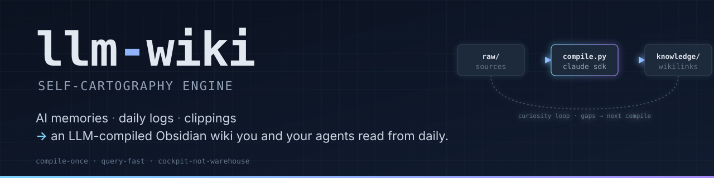
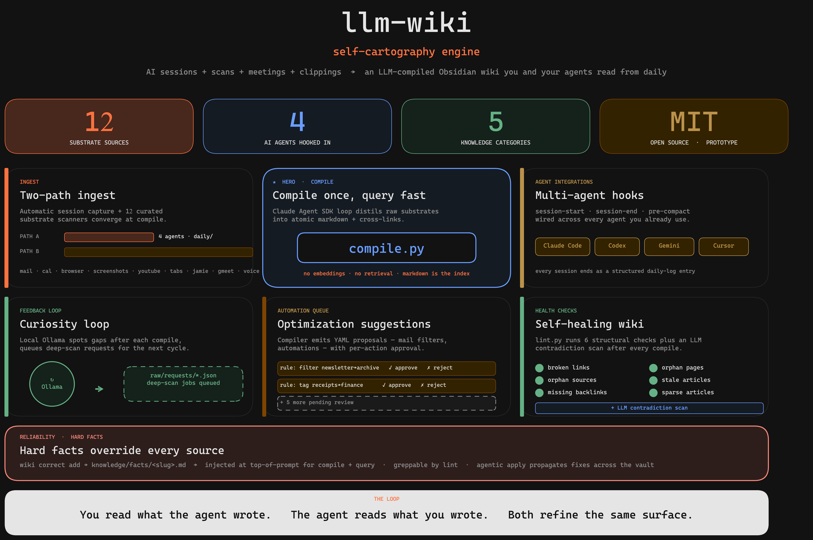
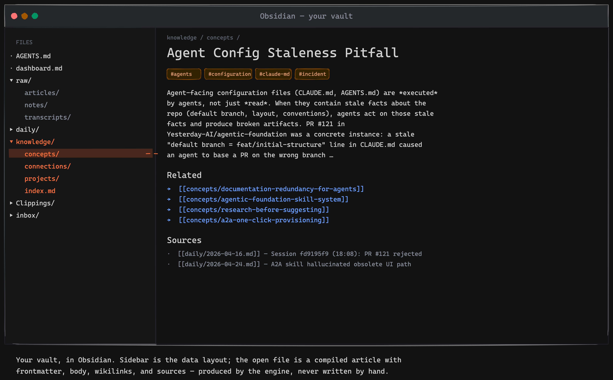

<p align="center">
  
</p>

<p align="center">
  <em>Self-cartography engine.</em>
</p>

<p align="center">
  Turn your scattered personal data into a queryable Obsidian wiki. You and your agents read from the same surface.
</p>

<p align="center">
  <a href="./LICENSE"></a>
  
  
  
  
  
</p>

> [!WARNING]
> **Heavy prototype development.** This is a single-author scratch space, not a stable tool. Architecture, CLI surface, file layout, and config schema can break at any time without notice or migration path. No semver, no deprecation cycle, no compatibility promises. If you install it, expect to read commits before pulling.

<table align="center">
  <tr>
    <td align="center"><strong>14</strong><br/>substrate collectors</td>
    <td align="center"><strong>8</strong><br/>psychometric instruments</td>
    <td align="center"><strong>MIT</strong><br/>open source</td>
  </tr>
</table>

> Yesterday's Claude Code session is already a daily-log entry. This week's screenshots already have a summary article. Open a fresh agent session and the wiki index loads before you type. **You read what the agent wrote. The agent reads what you wrote. Both refine the same surface.**

## Contents

- **Deciding whether to use it:** [What is this](#what-is-this) · [Why it exists](#why-it-exists) · [What you get](#what-you-get) · [In Obsidian](#what-it-looks-like-in-obsidian) · [Two ingest paths](#two-ingest-paths-converge-at-compile) · [A compiled article](#what-a-compiled-article-looks-like) · [Compile once](#the-defining-choice-compile-once-query-fast)
- **Installing and running it:** [Engine vs. vault](#engine-vs-vault-split) · [Install](#install) · [Update](#update) · [Commands](#commands)
- **Reading further or contributing:** [Documentation map](#documentation-map) · [Security](#security) · [For contributors](#for-contributors)

## What is this

An opinionated **knowledge-compilation engine** for personal substrates. Drop raw materials in — daily session logs, web clippings, screenshots, emails, calendars, browser history, HTML files — and a Claude Agent SDK loop compiles them into atomic Markdown articles with wikilinks. Renders as a navigable wiki inside [Obsidian](https://obsidian.md). The same wiki gets injected into every AI-agent session as context, so the loop closes: you read what you wrote, the agent reads what it wrote, both refine the same surface.

The vault holds **data**. The `.wiki/` directory holds the **engine**. They never mix on disk.

**A map, not an agent.** The wiki is a *map of the operator* — a compiled, always-current, descriptive portrait of what you know, did, and committed to, read daily by you and your agents. It describes; it doesn't act. That's why it's a *self-cartography engine*, not a "second brain": "brain" implies the part that thinks and does, which is deliberately out of scope. Anything that *acts* on the map — automating a task, syncing a commitment to an external tool — is an operator-gated consumer **downstream** of the compiler, never the compiler itself.

**What this isn't.** Not a vector database, not a RAG service, not a Notion / Logseq / Mem replacement, not a docs-site generator, not a team wiki — and not a task manager, executive/agent layer, or "second brain." It is a *compile loop* for one operator's substrates, output as plain Markdown that any tool can read.

## Why it exists

A solo knowledge worker's thinking lives in too many partial substrates: daily notes capture *what happened*, AI-agent memories capture *working thought*, clippings capture *curiosity*, screenshots and calendars capture *everything else*. Each is queryable in isolation, but not as a whole — and most are illegible even to the person who produced them.

Existing tools either solve a slice or solve a different problem:

- **[Karpathy's LLM Wiki](https://gist.github.com/karpathy/442a6bf555914893e9891c11519de94f)** — the `raw/` → `knowledge/` shape and the compile-don't-retrieve choice; a sketch, not a working pipeline.
- **[claude-memory-compiler](https://github.com/coleam00/claude-memory-compiler)** (Cole Medin) — the session-capture pattern; only handles AI-agent memories, doesn't ingest other substrates.
- **Obsidian, Notion, RAG systems** — manual curation, team docs, or retrieval without compilation (weak cross-doc reasoning).

llm-wiki is the **compilation layer** between raw substrates and active consumption — by humans reading and by agents prompting. It is not an archive to be left behind; it is a working surface that gets refined by being used.

## What you get

**The map** — substrates in, a compiled wiki out:

- **Two-path ingest + per-day rollup** — automatic session capture (hooks → `daily/<date>/sessions.md`) and substrate-source writers (Registry-discovered Collectors + clipper + manual drop → `raw/`, plus per-day mirror summaries into `daily/<date>/{health,meetings,voice,email,pictures,captures}.md` — email carries top senders + recent subjects, not just a count) converge at one compiler. A daily-digest pass distills the per-source captures into a single `daily/<date>.md` (~500 words). All fourteen collectors ride the formal Collector Protocol (`SPEC` + `@register` + `run()`), registered lazily by name: email, calendar, jamie, gmeet, wispr, voice, pictures, capture, health, screenshots, browser, tabs, youtube, folder-index.
- **Multi-agent hooks** — `session-start` / `session-end` / `pre-compact` wired into Claude Code, Codex, Gemini, and Cursor. Every session ends as a structured daily-log entry.
- **Curiosity loop** — a small local Ollama model spots gaps after each compile and queues deep-scan requests for the next cycle.
- **Self-healing wiki** — `lint.py` runs 18 structural checks (links, orphans, staleness, article shapes and schema, fact violations, …) plus an LLM contradiction scan, so the wiki stays consistent as it grows.

**Consumers of the map** — operator-gated layers that *read* the compiled wiki; where they act, only with explicit approval, downstream of the compiler:

- **Surfaced commitments** — the compiler *reads back* the commitments your substrate reveals (jamie + gmeet transcripts; Task / Owner / Deadline / Context quartet) and surfaces them on the relevant `knowledge/people/<slug>.md` + `knowledge/projects/<slug>.md` entity pages as `## Action Items` (Obsidian-Tasks-plugin syntax) and `## Open Threads`. Resolved items demote to Timeline on the next compile; a dashboard pane + cross-entity Inbox MOC make them legible. This *surfaces* commitments as part of the portrait — it does **not** manage them: reminders, completion-as-workflow, and syncing to an external task tool are out of scope (a downstream consumer's job).
- **Optimization suggestions** — the compiler proposes YAML automations (e.g. mail-filter rules) with per-action approval before execution.
- **Remote mirror (MCP)** — `wiki publish` mirrors the vault's markdown one-way into a managed wiki on the operator's [meinkontext](https://github.com/Yesterday-AI/context-mcp) server, so every agent anywhere reads the same corpus over MCP. Idempotent by content hash, wikilinks normalized to global slugs, deletions archive upstream; one browser OAuth consent (`wiki publish --auth`), then a compile piggyback keeps it fresh. See [`docs/setup-publish.md`](docs/setup-publish.md).
- **Operator self-reports** — air-gapped analytical surface at `<vault>/reports/`. Validated clinical screens (PHQ-9, GAD-7, WHO-5, PSS-10, ISI, OLBI, K6, ASRS v1.1) scored by an informant agent reading the operator's own substrate. Deterministic Likert + cutoffs; the LLM only fills in raw answers. Two-pass analyst (per-study + cross-study). `wiki study run <id>` + `wiki analyze`. See [`docs/cli.md`](docs/cli.md#operator-self-reports-analytical-surface).



<sub>High-level dashboard. For the full cognitive-architecture diagram see [`docs/architecture.png`](docs/architecture.png). Both rendered from `.excalidraw` files in [`docs/`](docs/).</sub>

## What it looks like in Obsidian



The sidebar is the data layout — `raw/`, `daily/`, `knowledge/` — exactly the folders the compiler creates and reads. The open file is a compiled article: frontmatter, body, wikilinks, and sources, none of it written by hand.

## Two ingest paths converge at compile

```text
PATH A — Automatic capture                PATH B — Curated sources
─────────────────────────────             ──────────────────────────────────
session-start / session-end /             Collectors (Registry — fourteen):
pre-compact hooks attach to every         · mail, calendar   email, calendar
Claude Code / Codex / Gemini /            · meetings         jamie, gmeet, wispr
Cursor session. flush.py extracts         · mobile inboxes   voice, pictures, capture
the conversation transcript and           · body             health (Oura)
appends a structured entry to             · screen, web      screenshots, browser,
daily/<date>/sessions.md, then a                             tabs, youtube
daily-digest agent distils all            · local folders    folder-index (body-blind)
per-source captures into
daily/<date>.md (~500 words).             Other writers:
                                          · clippings-sweep  (Obsidian Web Clipper)
            │                             · ingest-html      (file or URL)
            │                             · process-inbox    (LLM-classified drop)
            ▼                                          │
   daily/<date>/<source>.md +                          ▼
   daily/<date>.md (compile digest)       raw/{articles,papers,notes,transcripts,voice,
            │                                  audio,captures,index,requests,suggestions}/
            └──────────────┐    ┌──────────────────────┘
                           ▼    ▼
                  ┌────────────────────┐
                  │     compile.py     │   Claude Agent SDK loop.
                  │                    │   Reads index.md + AGENTS.md (vault),
                  │                    │   walks raw/ + daily/, distils into
                  │                    │   atomic articles + cross-links.
                  └────────────────────┘
                           │
                           ▼
                  ┌────────────────────┐
                  │     knowledge/     │   LLM owns; you and your agents read.
                  │  concepts/         │
                  │  connections/      │   ← cross-source links
                  │  people/ projects/ │
                  │  qa/               │
                  │  facts/            │   ← human-owned hard facts (override sources)
                  │  MOCs/             │   ← curated topic hubs (Maps of Content)
                  │  index.md          │   ← master catalogue
                  └────────────────────┘
```

After every compile, two side loops run on the new article:

- **Curiosity loop** — a small local Ollama model spots gaps and writes JSON deep-scan requests to `raw/requests/`. The next compile cycle picks one up and fills the gap.
- **Optimization suggestions** — the compiler emits YAML proposals to `raw/suggestions/` for repeatable manual actions (e.g. mail filter rules). `wiki suggestions` applies them only after explicit per-action approval.

When raw sources contradict reality — a Slack thread that calls a project by its old name, an old memo that claims a never-won award — `wiki correct` lets you write a **hard fact** to `knowledge/facts/<slug>.md`. Hard facts inject into compile + query prompts at the highest authority, so future compilations honour them automatically. `wiki correct apply <slug>` then spawns an agent that walks the existing wiki, strikes contaminated claims, fixes wikilinks, and — for disambiguation facts — renames files. Raw sources stay immutable; only `knowledge/` (and minimal correction notes in `daily/`) are touched.

More passes over the compiled wiki, each in [docs/cli.md](docs/cli.md#synthesis--maintenance):

- `wiki reconcile` — fixes concepts that contradict a hard fact, write-scoped to `knowledge/concepts/`; dry-run by default and off until you opt in.
- `wiki health-trends` — a deterministic `## Trends` block over the health corpus ($0, no LLM); off by default.
- `wiki dedup` — finds the duplicate entity pages speech-to-text leaves behind; every merge is operator-confirmed.
- `wiki dream web-research` — a labelled `## Public Profile` for public people via Exa; opt-in per vault and per entity.
- `wiki usage` — where the model budget goes, in tokens per provider/model, never dollars.

## What a compiled article looks like

A real `knowledge/concepts/agent-config-staleness.md` from a working vault — illustrative excerpt:

```markdown
---
title: "Agent Config Staleness Pitfall"
aliases: [stale-claude-md, stale-agent-config, wrong-base-pr-incident]
tags: [agents, configuration, claude-md, incident]
sources:
  - "daily/2026-04-16.md"
  - "daily/2026-04-24.md"
created: 2026-04-16
updated: 2026-05-02
---

# Agent Config Staleness Pitfall

Agent-facing configuration files (CLAUDE.md, AGENTS.md) are *executed* by
agents, not just *read*. When they contain stale facts about the repo
(default branch, layout, conventions), agents act on those stale facts and
produce broken artifacts …

## Key Points

- **CLAUDE.md is not documentation — it's instructions.** Agents follow it
  like a runbook. Outdated facts produce outdated actions. Freshness is the
  counter-pattern to [[concepts/documentation-redundancy-for-agents]].

## Sources

- [[daily/2026-04-16.md]] — Session `fd9195f9` (18:08): PR #121 rejected
- [[daily/2026-04-24.md]] — A2A skill hallucinated obsolete UI path
```

Three things to notice:

- **Frontmatter** is structured (aliases, tags, sources, dates) so Dataview queries hit it cleanly.
- **`[[wikilinks]]`** point both *into* the wiki (`concepts/...`) and *back to durable sources* (`daily/...`, `raw/notes/...`, `raw/articles/...`, `raw/transcripts/...`) — the audit trail is part of the article, not a metadata field.
- **The article is atomic.** It argues one idea, cites two different days' sessions, and links to sibling concepts. The compiler chose this granularity from the raw substrates; nothing is hand-curated.

## The defining choice: compile once, query fast

Knowledge is distilled into Markdown wikilinks at compile time — no embedding step, no retrieval at every query.

| Approach | Cost per query | Latency | Cross-doc reasoning |
|---|---|---|---|
| RAG | re-embed + retrieve every time | seconds | weak — chunks are isolated |
| llm-wiki | one-time compile per source | ms — it's already markdown | strong — LLM saw all sources during compile |

**Speed compounds.** Every query is a Markdown read, so the wiki ends up read more often than it's written — by you, and by every agent you give vault access to. That inversion (output → input ratio greater than 1) is the point.

The architecture wrapped around Karpathy's shape and Cole Medin's session capture — collectors, two-path ingest, curiosity loop, suggestions, lint, hooks across multiple agents, the engine/vault split — is the work of this project. Full design rationale in [docs/concept.md](docs/concept.md); hard-won engine learnings (Ollama gotchas, rate-limit debugging, anti-patterns) in [.ytstack/KNOWLEDGE.md](.ytstack/KNOWLEDGE.md).

## Engine vs. vault split

```text
<vault>/
├── AGENTS.md              ← article-schema spec (seeded from templates/, then yours)
├── dashboard.md           ← Dataview home page (seeded from templates/, then yours)
├── raw/                   ← immutable curated sources (LLM reads, never writes)
├── daily/                 ← per-day rollup: <date>/<source>.md per-source captures + <date>.md compile-stage digest
├── knowledge/             ← LLM-compiled wiki (LLM owns, you and agents read)
├── reports/               ← operator self-reports (air-gapped from compile): studies/<id>/runs/<ts>/instruments/*.md + _summary.md + _analysis.md, plus analyses/ for Pass-2
├── inbox/                 ← transient — `wiki process-inbox` classifies + moves to raw/
├── Clippings/             ← optional — Obsidian Web Clipper drop point
├── .obsidian/             ← Obsidian config (community-plugins, core-plugins seeded)
├── .claude/skills/        ← symlinks to .wiki/skills/<name> (auto-discovered)
└── .wiki/                 ← engine — hidden from Obsidian, never modified by hand
```

The vault holds the **data**. `.wiki/` holds the **engine**. The two never mix on disk. The engine's internal layout is documented in [docs/engine-layout.md](docs/engine-layout.md).

## Install

```bash
curl -fsSL https://raw.githubusercontent.com/lx-0/llm-wiki/main/install.sh | bash
# or with explicit target:
curl -fsSL https://raw.githubusercontent.com/lx-0/llm-wiki/main/install.sh | bash -s -- ~/path/to/vault
```

The installer clones into `<target>/.wiki/`, seeds `config.yaml` from `config.example.yaml`, and runs `wiki seed`. That first `wiki` call creates the Python environment at `<target>/.wiki/.venv/` (or at `~/.venvs/<vault>-wiki` when the vault sits in iCloud Drive / CloudStorage — cloud sync evicts files and kills running binaries; the engine addresses that environment via `UV_PROJECT_ENVIRONMENT`). The seed fills the vault root from `.wiki/templates/` — but **only when each target file is absent**, never overwriting existing work — and `wiki skills sync` links the engine's skills.

| Created path | Source | Purpose |
|---|---|---|
| `<vault>/AGENTS.md` | `templates/AGENTS.example.md` | Article-schema spec read by every compile prompt. Edit the *Vault Owner* + *Language* sections. |
| `<vault>/dashboard.md` | `templates/dashboard.md` | Obsidian Dataview home (recently-compiled / wiki stats / recent daily logs). |
| `<vault>/.obsidian/{community,core}-plugins.json` | `templates/.obsidian/` | `dataview` + `obsidian-excalidraw-plugin` for first-launch approval; core defaults (daily-notes, properties, graph on; sync/publish off). |
| `<vault>/.claude/skills/use-llm-wiki` | symlink to `.wiki/skills/use-llm-wiki` | The one bundled engine-side skill — lets agents query, contribute, or diagnose this wiki via the `wiki` CLI from any project. *Global-eligible*: `wiki skills install --global` links it into `~/.claude/skills/` so agents anywhere can reach it. The other operator skills (`engine-pr`, `excalidraw-diagram`, `ingest-audio`, `vault-health-check`, `vault-triage`) ship via the Claude Code plugin marketplace `yesterday-public-plugins`, not as repo-bundled skills. |

**Prerequisites:** `bash`, `git`, `uv` (Python package manager). Optional but recommended: a local [Ollama](https://ollama.com) — the curiosity loop, screenshot vision, inbox classification, HTML visual analysis, and per-article review all run on local models. The Claude paths (compile, query, lint contradiction check, flush) work without it.

After install:

```bash
cd ~/path/to/vault
./.wiki/wiki setup        # 6-question wizard (Ollama URL, compile model, compile-after hour, …)
./.wiki/wiki status       # config + hook install table + Ollama probe
./.wiki/wiki              # interactive home screen — what's pending + browse by group
```

## Update

```bash
./.wiki/wiki update                # git pull --ff-only + sync skill symlinks into .claude/skills/
./.wiki/wiki skills status         # per-skill linked / collision / missing table + global state
./.wiki/wiki skills install        # ad-hoc resync without pulling
./.wiki/wiki skills install --global  # also link use-llm-wiki into ~/.claude/skills/ + register vault
./.wiki/wiki seed                  # additive: add missing vault templates (dashboard, plugin configs)
./.wiki/wiki seed --force          # overwrite existing templates with engine versions
```

`wiki update` pulls into `.wiki/` (preserves `config.yaml`, re-syncs the environment where it lives), then runs `wiki skills sync` so newly-shipped engine skills land in `<vault>/.claude/skills/` automatically. Foreign entries (your own skills, other tools' symlinks) are never touched. When `skills.global_install` is on, the sync also refreshes the global `~/.claude/skills/` symlink — the opt-in survives updates with no re-flagging.

If the `.wiki/` checkout has uncommitted changes to **tracked** engine files (direct edits inside `<vault>/.wiki/` — which a `--ff-only` pull would otherwise refuse), `wiki update` lists them and offers to `git stash` them so the pull can proceed. After pulling it re-applies the stash automatically, but only if it merges cleanly onto the new engine; if it would conflict, the stash is left unpopped (recover with `git -C <.wiki> stash pop`). Run it from a terminal — non-interactively (e.g. dashboard button) it refuses rather than touching your changes. (`config.yaml`, `state/`, `logs/` are gitignored and never trigger this.)

`wiki seed` re-applies engine templates to the vault root after an update — adds missing files (`dashboard.md`, `_dashboard-stats.md`, `.obsidian/plugins/<name>/data.json`) and **merges** `community-plugins.json` (additive — never drops your own plugins). Default mode never overwrites your existing files; use `--force` to replace customisations of `dashboard.md` / `AGENTS.md` with the engine version.

## Commands

Bare `./.wiki/wiki` opens the **home screen**: a status line (`384 articles · last compile 4h ago · ollama ✓`), what is pending in your vault (`3 files in inbox/ → process-inbox`), a health banner when something is broken (missing hooks, unreachable Ollama, recent compile errors) with the fix, the shortcut keys, and the command groups to browse — the same groups `wiki help` prints, from one command table. `/` filters every command. Without a terminal (CI, hooks, pipes) it prints the help and exits. Agents read the same state as JSON: `wiki menu --json` (what's pending) and `wiki doctor --json` (config, connectivity and pipeline audit; `--quick` for hook use). Run engine code through `wiki`, not a bare `uv run`: on a cloud-synced vault that rebuilds the environment inside the vault. Full reference — every subcommand, every config key, every hook target — in [docs/cli.md](docs/cli.md).

## Documentation map

| Doc | What's inside |
|---|---|
| [docs/PRINCIPLES.md](docs/PRINCIPLES.md) | The ten core rules — constitution of the wiki, with verbatim Karpathy / OpenClaw / own quotes + attribution |
| [docs/concept.md](docs/concept.md) | Three-layer architecture, compile-vs-RAG, cognitive-function mapping, curiosity loop |
| [docs/PROCESS.md](docs/PROCESS.md) *(German)* | Live documentation of every data flow inside the engine — numbered processes (German prose, English diagrams; a PR that touches a flow keeps the prose language) |
| [docs/cli.md](docs/cli.md) | Full CLI reference — every `wiki <subcommand>`, the home screen, every hook target |
| [docs/config.md](docs/config.md) | Every config key, generated from the schema |
| [docs/FEATURES.md](docs/FEATURES.md) | Implementation map of every engine feature — status, code location, trigger, known gaps. Maintained alongside code. |
| [docs/engine-layout.md](docs/engine-layout.md) | File-by-file tree of `.wiki/` — the engine internals |
| [docs/naming.md](docs/naming.md) | Naming conventions for raw sources and knowledge articles |
| [docs/architecture.png](docs/architecture.png) | Full Excalidraw render of the cognitive architecture |
| [docs/meeting-collectors-architecture.md](docs/meeting-collectors-architecture.md) | Jamie and Wispr direct HTTP collectors: authentication, source capture, daily provenance and compilation |
| [AGENTS.md](AGENTS.md) | Conventions for AI agents working on **this codebase** (separate from the vault's own AGENTS.md) |
| [.ytstack/PROJECT.md](.ytstack/PROJECT.md) | Project framing, success criteria, current status |
| [.ytstack/DECISIONS.md](.ytstack/DECISIONS.md) | Locked architectural choices |
| [.ytstack/KNOWLEDGE.md](.ytstack/KNOWLEDGE.md) | Hard-won engine learnings (Ollama, rate limits, anti-patterns) |

## Security

Secrets never enter git: gitleaks runs in CI on every push and PR and nightly ([secrets-scan.yml](.github/workflows/secrets-scan.yml)) and blocks the merge on a leak, and the [pre-commit](.pre-commit-config.yaml) hooks run it before a commit (`pip install pre-commit && pre-commit install`). Rules and allowlist: [.gitleaks.toml](.gitleaks.toml); a manual scan is `gitleaks detect --no-banner -v`. If you find a leak in history, rotate the secret immediately, then file an issue (don't post the leaked value). The code gates — ruff, ty, the size gates, the pytest suite — are listed in [AGENTS.md](AGENTS.md#style).

## For contributors

Engine internals (file-by-file tree, how a module runs) live in [docs/engine-layout.md](docs/engine-layout.md). Development conventions — how to add an agent target, a tunable, or a prompt; style, gates and side-effect rules — live in [AGENTS.md](AGENTS.md).
